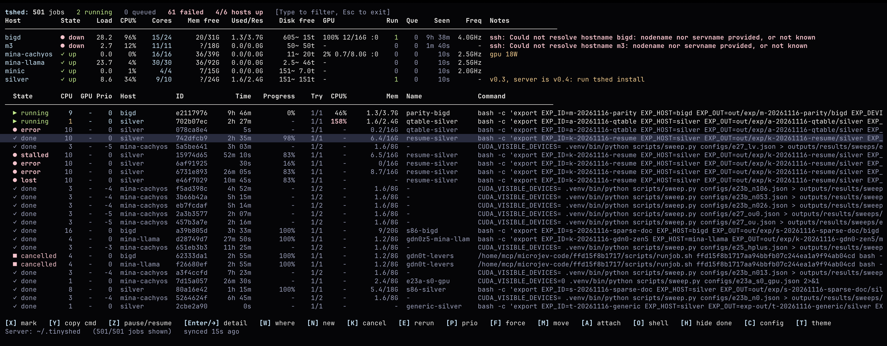
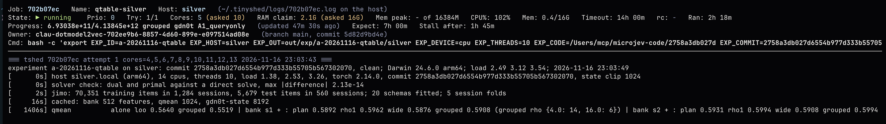

# tinyshed / tshed

Simple, powerful job scheduling for a handful of machines: one file, one command, ssh in between.

You have a laptop and a few boxes with cores and GPUs. tshed queues long jobs on them by priority,
gives each job its own cores, RAM and GPUs (or a share of one), takes back what the job does not use,
enforces runtime and memory limits, notices when a job stops making progress, retries what failed,
keeps every log, and moves your code there and your results back.

- **One file, one command to set up.** `tshed install HOST…` copies `tshed.py` to each host and starts
  its agent, about a second per host. It is stdlib-only Python, with no daemon on the server and nothing
  else to install on the hosts.
- **ssh is the transport, and nothing more.** Every server→host interaction is one idempotent `ssh` call,
  JSON in and out, so a lost connection just means "try again". There is no broker and no protocol of
  tshed's own: ssh already does authentication and encryption.
- **mosh for looking in.** Following a running job's log, or opening a shell on its host, goes over mosh
  (ssh where mosh's UDP does not get through).
- **Cores claimed with `taskset`, placed by the CPU's layout.** Each job is pinned to cores of its own:
  whole physical cores before SMT siblings, as few L3 cache groups as possible, the fast cores near the
  GPU for GPU jobs. See [Which cores](#which-cores).
- **Over-allocation is reclaimed.** Each host measures what every running job really uses (CPU, RAM, GPU
  share, VRAM) and cuts claims larger than that down to fit, so waiting jobs get the rest. See
  [Fitting claims to use](#fitting-claims-to-use).
- **Strictly greedy by priority.** The highest-priority job is first in line and gets first pick of
  whatever is free; nothing behind it takes what it is waiting for. See [Claims](#claims-cores-ram-gpus).
- **Jobs that break their limits are killed.** A job over its RAM limit (`-m`, the whole process tree),
  its runtime limit or its stall limit is terminated, process group and all, and ends as `oom`,
  `timeout` or `stalled`: retried if you allowed it.
- **Disk and RAM are watched.** Every host reports free disk (home and `/tmp`), free memory and each
  job's live and peak RSS against what it reserved; a disk under 2 GB turns red and fires `OnCriticalDisk`.
- **Hosts are authoritative.** Each host keeps its own queue and event log in sqlite and keeps
  scheduling, retrying and logging while the server is unreachable; the server catches up later.
- **Expected runtime and progress.** Every job can declare how long it should take (`-x`; the timeout
  defaults to twice that) and report checkpoints; a job that stops checkpointing is killed as `stalled`.
- **Code in, results out.** `--git` runs a job on an exact snapshot of your working tree (uncommitted
  edits included), `--pull` copies its outputs into local folders when it ends.
- **Inspectable.** `tshed where` shows a running job's process tree, the line each bash script is on
  and python stacks; `grep` searches every log on every host; `stats` gives runtimes per job name.
- **Tested.** 132 unit tests in one stdlib file, `./run_tests.sh`, done in under two seconds: no ssh, no
  daemons, never your live queue. See [Development](#development).
- **A dashboard** with type-to-filter, multi-select, pause/resume, live logs, attach and themes. It is
  pure Python like the rest (no curses, just escape codes) and answers a key in 3-4 ms. The mouse works
  too: the wheel scrolls, a click selects, a second click opens the job, ctrl-click marks it.



```
server (your machine)                   host (each)
~/.tinyshed/server.db  (mirror)         ~/.tinyshed/host.db   (authoritative, sqlite WAL)
tshed / tshed serve   ── ssh: rpc ──▶   agent ──▶ watchdog ──▶ taskset -c … bash -c CMD
                      ◀─ ssh: ingest ── (phone home, optional)
```

## Requirements

- Python ≥ 3.12 on the server and every host, and zstd: built in from Python 3.14, otherwise the `zstd`
  binary or `pip install pyzstd` / `zstandard`. `install` refuses a host without it.
- ssh from the server to each host (key-based; `~/.ssh/config` aliases work).
- On hosts, optionally: `taskset` (core pinning, Linux), `git` and `rsync` (`--git`, `--push`, `--pull`),
  `mosh-server` (attach), `nvidia-smi` (GPU stats), `py-spy` (python stacks in `where`).
- Linux hosts get everything; macOS works as a host too, without core pinning and with rougher RSS.

## Quick start

```sh
ln -s "$PWD/tshed.py" ~/bin/tshed                    # anywhere on PATH; the command is `tshed`
tshed install gpu1=gpu1.local,gpu1 gpu2=me@gpu2         # copy itself to each host, start its agent (~1 s per host)
tshed hosts                                             # load, CPU%, idle cores, memory, GPUs
tshed submit -n hello -H gpu1 -x 60 -- 'echo hi from $(hostname); sleep 30'
tshed ls                                                # or just `tshed` for the dashboard
tshed completion fish > ~/.config/fish/completions/tshed.fish   # or zsh / bash
```

`HUMANS.md` is a step-by-step tutorial. `skills/tshed/SKILL.md` teaches coding agents to use it.

## Setting up hosts

A host is any machine the server can ssh into. There is nothing to install on it by hand except zstd.

1. **ssh without a password.** `ssh gpu1 true` must work from the server with no prompt: tshed runs ssh
   in batch mode. `ssh-copy-id gpu1` if it does not; aliases, users and ports from `~/.ssh/config` apply.
2. **Python ≥ 3.12 and zstd on the host.** `python3` on its `PATH`; before Python 3.14 also the `zstd`
   package (`apt install zstd`, `pacman -S zstd`) or `pip install pyzstd`.
3. **Install from the server:**

   ```sh
   tshed install gpu1                         # the ssh destination is also the host's name
   tshed install gpu1=gpu1.local,gpu1         # NAME=DEST; alternatives are tried in order (LAN, then VPN)
   tshed install big=me@big --cores 0-15      # jobs may use only these cores
   tshed install gpu1 gpu2 --home me@laptop   # hosts push events back to the server (phone home)
   ```

   This checks the host, copies `tshed.py` to `~/.tinyshed/tinyshed.py`, starts the agent, makes it start
   at boot (crontab `@reboot`, else a systemd user unit; `--no-boot` skips it) and registers the host on
   the server. It prints one line per host with its version, Python, zstd, cores and anything missing
   (`taskset`, `mosh-server`).
4. **Check:** `tshed hosts` shows it `up` with its cores, memory, disk and GPUs.

- **Upgrade:** `tshed install` with no hosts re-installs every registered host; `tshed install gpu1` one.
  Running jobs are not disturbed, and options you leave out keep their installed value.
- **Per-host settings** (cores, claimable GPUs, RAM, slack): `tshed config --host gpu1 --edit`. See
  [Config](#host-columns).
- **Remove:** `tshed uninstall gpu1` stops the agent and removes the boot entry; the host's queue and
  logs stay unless you add `--purge`.
- **Optional on a host:** `taskset` (core pinning), `git` and `rsync` (`--git`, `--push`, `--pull`),
  `mosh-server` (attach), `nvidia-smi` (GPUs), `py-spy` (python stacks).

## A job, end to end

```sh
cd ~/proj/train                         # a git repo; uncommitted edits are fine
tshed stats train --json                # earlier runtimes of this name, to pick -x
tshed submit -n train -H gpu1 -c 8 -m 32G -g 1 -x 3h -r 1 \
    --git --push ~/data/imgs:data --pull out:~/results/{name}/{id} \
    -- python train.py --lr 3e-4
tshed wait -t 4h train                  # → 1a2b3c4d done pulled out → /Users/me/results/train/1a2b3c4d
```

The job runs on gpu1 in its own checkout of your working tree, in the same subdirectory, with
`data/` copied next to it. It gets 8 pinned cores, 32 GB of RAM (also its RSS limit), one GPU of its own
(`CUDA_VISIBLE_DEVICES`) and a 6 h timeout (2 × `-x`). If after two minutes it uses less of any of these,
the claim shrinks to fit, so other jobs can use the rest.
If it exits with an error (or its host reboots), it is retried once. When it ends, `out/` is copied to the local folder, along with
`tshed-ID.json` recording what produced it. The checkout on gpu1 is then deleted. The code stays
recoverable with `tshed checkout ID`.

Inside the script, report progress after each unit of work:

```python
import os

def progress(line):                     # no-op outside tshed
    if p := os.environ.get("TINYSHED_PROGRESS"):
        with open(p, "w") as f:
            f.write(line + "\n")

for i, shard in enumerate(shards, 1):
    train_on(shard)
    progress(f"{i}/{len(shards)} {shard}")
```

With `-x 3h` and 12 shards, a shard that takes over 2 × 15 min (twice its share of the expected time) kills the job as `stalled` instead of
letting it hang until the timeout. The dashboard shows percent done and an ETA.

## Commands

| command | |
|---|---|
| **hosts** | |
| `install [[NAME=]DEST…] [--cores 0-15] [--home DEST] [--no-boot]` | check each host, copy the file, (re)start its agent, start it at boot, register it. No hosts = upgrade all. `DEST` is an ssh destination, alternatives tried in order (`gpu1.local,gpu1`: LAN, then VPN name), or `local[:DIR]`. Options left out keep their installed value. Safe while jobs run |
| `uninstall NAME… [--purge] [--force]` | stop the agent, remove the boot entry, forget the host; data stays unless `--purge` |
| `hosts [--json] [--rm NAME]` | last known state of every host, without contacting them (`Seen` = its age; `ls`, `serve` and the dashboard refresh it): see [Host columns](#host-columns) |
| `score [HOST] [--from DIR] [--cpu N] [--gpu N] [--clear]` | each host's CPU and GPU score: the order host-less jobs try hosts in. See [Host scores](#host-scores) |
| `config [--edit] [--host HOST…]` | show or edit (in `$VISUAL`/`$EDITOR`) this machine's `config.json`, or a host's over ssh; validated before saving, applied within a second |
| **jobs** | |
| `submit -n NAME [flags] -- CMD` | queue a job; prints `ID STATE HOST`. See [Submitting](#submitting) |
| `ls [-a] [--json] [--owner TEXT] [--mine]` | active jobs (`-a`: finished too); only one owner's, or your own. See [Owners](#owners) |
| `owner [ID] [--json]` | your owner id, or an owner's jobs, where it submitted from and its agent session file |
| `overview [-n N] [-a]` | hosts and active jobs in one non-interactive screen |
| `show ID` | one job: state, limits, rc, times, progress, code and file status, end of its log |
| `logs ID [-n BYTES] [-f]` | its captured stdout+stderr; `-f` follows it live on the host (mosh/ssh, interactive) |
| `wait ID… [-t 2h] [-i 5]` | block until done; exit 0 all done, 1 any failed, 2 timed out. Pulls results of the jobs it waited for |
| `cancel ID…` · `prio ID N` | |
| `edit ID [-p N] [-H HOST\|any] [--force]` | change a waiting job: priority, host, or start it now. See [Controlling jobs](#controlling-jobs) |
| `pause ID…` · `resume ID…` | stop a running job and free its cores / continue it when cores are free |
| **inspecting** | |
| `where ID [--json]` | what a running job is doing: process tree, bash script lines, python stacks. See [Where is it?](#where-is-it) |
| `grep PATTERN [ID…] [-i] [-l] [--name N] [--state S] [--since 2d] [-m N]` | search job logs on every host in parallel (Python regex); exit 1 if nothing matched |
| `stats [NAME…] [--since 30d] [--json]` | per job name: runs, done, failed, fail %, median / p90 / max runtime, latest `-x`, peak memory |
| **code and results** | |
| `fetch ID [SRC…] [--to DIR]` | copy results from the job's host now, in any state (a running job gives a snapshot) |
| `checkout ID [DIR] [--diff [--stat]]` | a `--git` job's exact code, or just the uncommitted changes it ran with |
| `progress [DONE/TOTAL\|PCT%] [MESSAGE]` | run inside a job: report a checkpoint. Does nothing outside a job |
| **server and looks** | |
| `tshed` / `tui [-i 5]` | the dashboard; while open it is also the server loop |
| `serve [-i 10]` | the server loop without a screen: delivers jobs, ingests events, pulls results, runs hooks |
| `theme [NAME] [--contrast N]` · `scheme […]` | color themes and per-role overrides: see [Themes](#themes) |
| `completion fish\|zsh\|bash` | tab completion, including host names and job ids |

An `ID` may be any unique prefix of a job id, or a job name (an unfinished job of that name wins).
Output is colored on a terminal and plain in a pipe; `NO_COLOR` is respected.

## Submitting

```sh
tshed submit -n NAME [-H HOST] [-p PRIO] [-c CPUS] [-m MEM] [-g GPUS [--vram MEM]] [-x EXPECT] [-t TIMEOUT] [flags] -- CMD
```

| flag | |
|---|---|
| `-n NAME` | required: 1-16 printable characters, no spaces; usable instead of the id |
| `-H HOST` | run on this host. Without it the server places the job on the best-scoring live host with room for it, else the next best (see [Host scores](#host-scores)), at the next sync (any `tshed` command, `serve` or the dashboard) |
| `-p N` | priority, higher first (default 0) |
| `-c N` | cores to claim and pin with `taskset` (default 1) |
| `-m 8G` | RAM to claim, and the RSS limit of the whole process tree → `oom` |
| `-g N` | GPUs to claim: a share of one (`0.25`) or a whole number (`2`). See [Claims](#claims-cores-ram-gpus) |
| `--vram 6G` | GPU memory to claim on each of its GPUs (default: the claimed share of the GPU's memory) |
| `--no-adjust` | keep the claims as submitted instead of fitting them to measured use |
| `-x 2h` | expected runtime: sets the default timeout and stall limit, gives an ETA. See [Progress](#progress-and-stalls) |
| `-t 12h` | runtime limit per attempt → `timeout` (default 2 × `-x`, else none) |
| `--stall DUR` · `--stall-on-log` | kill after DUR without a checkpoint → `stalled`; log output counts as one too |
| `-r N` · `--retry-on KINDS` · `--retry-delay DUR` | retry up to N times with doubling backoff on `error,lost` (default; add `timeout,oom,stalled` if those are transient for you) |
| `--git [PATH]` · `--push SRC[:DEST]` · `--pull SRC[:DEST]` · `--pull-on STATES` · `--keep-work` | ship code and files, bring results back. See [Code and results](#code-and-results) |
| `--trace-lines` | record every bash process's exact line for `where` (~0.1 ms per bash command) |
| `-C DIR` | working directory on the host (default `~`; with `--git`/`--push` relative to the job's own work dir) |
| `-e K=V` | environment variable, repeatable |
| `--owner ID` | who submits (default: detected, see [Owners](#owners)) |

`CMD` runs on the host through `bash -c`, in a non-login environment: paths are the host's, and
conda/modules need `bash -lc '…'`. Quote it as one argument if it has shell syntax:
`-- 'make 2>&1 | tail'`. Jobs see `TINYSHED_JOB`, `TINYSHED_ATTEMPT`, `TINYSHED_CORES` and
`TINYSHED_PROGRESS` (and `TINYSHED_OWNER`), and `~/.tinyshed/bin` first on `PATH` (so `tshed progress` works on every host).
A job with `-g` also gets `CUDA_VISIBLE_DEVICES` and `TINYSHED_GPUS` (its GPUs' indices) and `CUDA_DEVICE_ORDER=PCI_BUS_ID`,
so CUDA numbers GPUs as `nvidia-smi` does.

### Owners

Every job records who submitted it, as an id that leads back to the agent session:
`AGENT-ROOT-SESSION`, e.g. `clau-tinyshed-cf93301b-ae23-4aed-8cf3-f5ee3fa033ed`.

- `AGENT` comes from the session variable the submitting process sees: `CLAUDE_CODE_SESSION_ID` →
  `clau`, `MAKI_SESSION_ID` → `maki`. With neither it is `user` and there is no `SESSION`
  (`user-tinyshed`).
- `ROOT` is the project folder: the main repository's, so every worktree of a project shares it;
  outside git, the current folder.
- `--owner ID` sets it by hand; jobs submitted from inside a job inherit the job's owner
  (`TINYSHED_OWNER`).

The job also keeps its origin: agent, session, cwd, repository, branch, worktree (when it is not the
main one) and commit. `show` and the dashboard print it, and the dashboard's search matches owners.
`tshed owner` prints the id you would submit as; `tshed owner TEXT` finds owners by any part of the id
(a project, a session prefix) and lists their jobs, where they submitted from and the session's
transcript (`~/.claude/projects/*/SESSION.jsonl`, `~/.maki/sessions/SESSION.jsonl`) when it is on this
machine. `tshed ls --mine` / `--owner TEXT` filter the job list. Jobs from before owners show none.

**States.** `pending` (on the server: not placed yet, or its files are being staged) → `queued` →
`running` (⇄ `paused`) → `done` | `error` | `timeout` | `oom` | `stalled` | `lost` | `cancelled`.
`lost` means the job's watchdog died (kill -9, reboot); a retry, if allowed, starts it again.

## Claims: cores, RAM, GPUs

A job claims cores (`-c`), RAM (`-m`) and GPUs (`-g`, `--vram`). A host starts it only once all of them are
free; until then it stays queued.

- **Cores** are pinned with `taskset`, placed by the CPU's layout: see [Which cores](#which-cores).
  **RAM** is reserved against the host's physical memory (config `mem` overrides that). A job without `-m`
  claims no RAM.
- **GPUs.** `-g 1` is one GPU nobody else claims; `-g 2` is two; `-g 0.25` is a quarter of one, which
  other quarter-jobs may share. `--vram 6G` claims that much memory on each of its GPUs; without it a job
  claims the same share of the GPU's memory as of its compute (all of it for whole GPUs). Shares are
  placed first-fit by GPU index, so small claims pack together and whole GPUs stay whole. A job with
  GPUs never runs on a host without one; `submit` refuses a claim no host can meet.
- **Order.** Strict priority, FIFO within a priority, as before. A job that does not fit is never overtaken
  on what it waits for. If the head of the queue wants four GPUs and three are free, no job behind it gets
  a GPU until it starts (change its priority if that is not what you want). It also holds back the free
  cores and RAM it needs; jobs behind it may still use cores and RAM beyond that.
- **Paused** jobs keep their RAM and GPUs (their memory stays allocated) and give back their cores.
- **Forced** jobs (`edit --force`) take what they need at once, sharing busy cores and GPUs if they must.

### Which cores

`-c` counts logical CPUs, and a host picks them from its CPU layout (Linux sysfs, re-read every 10 minutes).
Each CPU has a physical core (SMT threads share one), an L3 group (the CPUs sharing a last-level cache: an
AMD CCX or CCD, an Intel cluster) and a speed rank (`amd_pstate`'s preferred-core ranking, else
`cpu_capacity`, else the top clock). Greedily, with no solver, a job gets:

1. **Wholly free physical cores** first: no two jobs share a core's threads while a whole core is free anywhere.
2. **As few L3 groups as possible.** A job that fits in one group gets the group it fills most tightly, so
   big groups stay free for big jobs. A job larger than any group takes whole groups first, then the rest.
3. **Then its own cores' second threads**, then, last, threads on cores another job uses.

GPU jobs get the fastest group that fits, near their GPU (the GPU's PCIe-local CPUs on multi-socket or
NPS machines), so feeder threads run on fast cores with an L3 of their own. CPU-only jobs on a host with
claimable GPUs fill from the slow end and leave the fast cores to GPU jobs; elsewhere they take the fast
cores first. On bigd (Ryzen 9 3900X: four CCXs of 3 cores, threads N and N+12), an idle host puts a
`-g 1 -c 2` job on CPUs 0,1 (the fastest CCX), a `-c 3` job on 9-11 (one whole CCX at the slow end), and twelve
`-c 1` jobs on twelve different physical cores. Where sysfs says nothing (macOS, VMs that hide their
topology) every CPU counts as its own core in one group: CPUs in order, as before. `hosts --json` has
`topology`: the L3 groups and whether cores have SMT siblings.

### Fitting claims to use

Most jobs claim more than they use: a CPU-starved CUDA job reaches 25% of its GPU, a job that claimed
5 GB settles at 1 GB. Each host's agent samples every running job every 2 s: CPU (cores busy), RSS and,
per GPU, utilization and VRAM (`nvidia-smi`, per process). After 120 s it cuts every claim larger than
`peak / (1 - slack)` down to that; `slack` is 0.2 by default (host config `slack`).

| claim | fitted to | step |
|---|---|---|
| cores | `peak cores busy / (1 - slack)`, at least 1. The job keeps one thread per physical core before both threads of one, in the L3 groups it used most, busiest cores first; every thread of the job is re-pinned (`sched_setaffinity`, as `taskset -acp`) | 1 CPU |
| RAM | `peak (RSS + swapped-out) / (1 - slack)`: swapped pages are still held (with zram, in RAM) | 100 MB |
| GPU share | `peak utilization / (1 - slack)`, per GPU | 5% |
| VRAM | `peak VRAM / (1 - slack)`, per GPU | 100 MB |

All are rounded up. Then the peaks are reset and sampling resumes after 10 s (threads migrate, caches
refill), for the next 120 s window. Each change is an `adjust` event (`OnJobAdjusted`: `before`, `after`
and the `peak` it was fitted to). The `CPU`, `GPU` and `Mem` columns show the current claims, amber where
fitted below what was asked; `show` prints both.

- Cores and GPU share only shrink. RAM and VRAM claims grow back as soon as use passes them, up to what
  was submitted, so the host never counts on memory a job holds.
- The `-m` RSS limit stays as submitted: fitting frees the claim for scheduling, not the job's headroom.
- GPU claims are fitted only once the job is seen using its GPU (256 MB of VRAM or any utilization), so a
  job that preprocesses on the CPU first keeps its GPU. CPU claims have no such guard: a job that runs
  single-threaded for its first two minutes keeps 2 cores afterwards. Use `--no-adjust` for jobs whose use
  comes in phases.
- GPU utilization is per process (`nvidia-smi pmon`), so other work on the GPU, inside tshed or not, is
  not charged to the job; a process `pmon` shows `-` for ran no kernel in its sample. Where `nvidia-smi`
  cannot see the job's pids (inside a container) or reports no per-process SM %, the GPU's own readings
  stand in, but only for a job alone on its GPU with nothing else loading it; otherwise the share is not fitted.
- A retry starts again from the submitted claims. A resumed job gets its submitted number of cores back;
  its RAM and GPU claims, held while it was paused, stay as fitted.

### Host scores

A job without `-H` goes to the best host first: the live host with the highest score that has room for it
now, else the next best, and so on. GPU jobs go by GPU score, all others by CPU score. Hosts without a
score come after those with one, by idle cores (GPU jobs: free GPU share). If no host has room, the job
waits on the server, and so do the jobs behind it.

```sh
tshed score --from ~/git/stdbench/bench-results   # import from stdbench's clpeak runs
tshed score                                       # the scores, and the order jobs try hosts in
tshed score mina-llama --cpu 41                   # set one by hand (0 = none); --clear drops both
```

- **CPU score:** the speed of one claimed CPU, from clpeak's newest complete run: the geometric mean of its
  integer, string-scan, CRC32C and UTF-8 rates per logical CPU, in G/s. clpeak's fp32 CPU kernels are left out
  because they miss Apple cores' SIMD and would put an M4 Pro below a Zen 2.
- **GPU score:** the host's best GPU, as the geometric mean of fp32 TFLOPS and memory bandwidth in 100 GB/s
  (RTX 4070 Ti SUPER 12.7, RTX 2070 SUPER 6.3). It matters only on hosts with claimable GPUs.
- A run made with a different CPU count than the host has now (a benchmark in a smaller container) is not
  imported for the CPU score: rerun it, or set the score by hand. Scores set by hand survive re-imports for
  hosts that have no usable run.
- Scores live in the server's registry (`server.db`), not on the hosts.

## Progress and stalls

`-x/--expect` declares how long a job should take. The timeout defaults to twice that. A job reports
progress by writing one line to the file `$TINYSHED_PROGRESS`: `DONE/TOTAL message`, `PCT% message`,
or any text.

```sh
for f in data/*.csv; do
  ./crunch "$f"
  tshed progress "$((++i))/$n" "$f"                  # atomic write; ~0.1 s of python startup
done
printf '%d/%d %s\n' "$i" "$n" "$f" > "$TINYSHED_PROGRESS"   # the same without python, for tight loops
```

Every write is a checkpoint, even an empty one: the watchdog checks the file's mtime, inode and size
every second, so a torn write still counts and nothing needs locking. `tshed progress` does nothing
outside a job, so scripts run unchanged elsewhere.

| | stall limit |
|---|---|
| `--stall 10m` | 10 min without a checkpoint, counted from the start; `0` = never |
| `-x` and a `DONE/TOTAL` or `PCT%`, no `--stall` | twice the time the expected rate allows for the progress of the last step, at least 10 s. A job reporting 3% per checkpoint with `-x 1h` gets 2 × 3% × 1 h ≈ 3.6 min per checkpoint, however often it reports |
| `--stall-on-log` (with `--stall`) | log output also counts: for commands you cannot edit that print as they go |

A stalled job is killed (state `stalled`, retryable). Checkpoints become `progress` events at most
every 30 s, so a fast loop does not grow the event log. The dashboard's Progress column shows percent
and ETA (amber when the ETA runs past the timeout), and `ls --json` has `progress`, `done` and `eta`.
Checkpoint after each unit of work, never from a background `while sleep` loop: that keeps a hung job
looking alive.

## Code and results

The server does all copying, over the same ssh connection as everything else.

- **`--git [PATH]`** snapshots the repository containing PATH (default `.`) exactly as it is on disk:
  commits, staged and unstaged changes, and untracked files that are not ignored. It builds the
  snapshot commit with a throwaway index, so your index and files are untouched, and stores it in
  `~/.tinyshed/snapshots/` on the server, not as a ref in your repository (`git log --all` stays clean).
  The server pushes it into a bare mirror on the host (only new objects travel) and checks it out as a
  worktree in `~/.tinyshed/work/ID`. The job runs in the subdirectory you submitted from; `-C` is
  relative to the repository root. Ignored files (data, venvs) are not shipped, so use `--push` for
  them. Untracked files over 100 MB in total stop the submit, listing the largest. Submodules and
  git-lfs contents are not shipped.
- **`--push SRC[:DEST]`** (repeatable) rsyncs a local file or folder into the job's working directory
  before it starts. DEST defaults to SRC's name and must stay inside that directory.
- **`--pull SRC[:DEST]`** (repeatable) rsyncs SRC, relative to the job's working directory, into the
  local folder DEST when the job ends in one of `--pull-on`. The default is every end state except
  `cancelled`. A folder's contents land in DEST; a file lands inside it. DEST may use `{name}` `{id}`
  `{host}` `{state}` and defaults to `results/{name}/{id}`. Each DEST gets `tshed-ID.json`: job,
  host, state, rc, command, times, snapshot and source. A DEST that tshed creates inside a git work
  tree gets a `.gitignore` of `*`, so results never end up in the next snapshot.

**When.** With `-H`, `submit` stages the files before queueing; if that fails, nothing is queued.
Other jobs are staged on their host before delivery: inline by `submit`, `wait` and `edit`, in the
background by `serve` and the dashboard. Pulls run as jobs end, in `serve` and the dashboard and at
the end of `wait`; `fetch` pulls on demand. Failures are shown by `show` and retried once a minute.
Every step is idempotent, and a checkout interrupted halfway is redone.

**Cleanup.** Work dirs are scratch. Once a job has ended and its pull succeeded (or it wanted none),
its work dir is deleted on every host that has a copy. Anything not in `--pull` goes with it;
`--keep-work` keeps it. The snapshot is kept for good: it holds only what differs from history. So
are the log and the job record. `tshed checkout ID` rebuilds the code, `tshed checkout ID --diff`
shows just its uncommitted changes.

## Inspecting jobs

**`ls` and the dashboard**: `State CPU Prio Host ID Time Progress Try CPU% Mem Name Command`.

- `Time` is the run time of the current attempt, without paused time. Waiting jobs show how long they
  have been waiting, in brackets: `(12m 05s)`.
- `CPU%` is the CPU time of the job's process tree over elapsed time × reserved cores: a 2-core job
  with one busy thread reads 50%.
- `Mem` is the tree's live RSS against its `-m` limit (`0.3/3.2G`), red above 90%. Finished jobs show
  their peak.
- `ls --json` adds every field: `ran`/`wait`, `progress`, `done`, `eta`, `paused_s`, `stage`, …

**`grep`** searches the logs of matching jobs on all hosts at once, live and compressed.
`tshed grep -i 'out of memory' --state error --since 2d` finds every recent OOM. `-l` only lists jobs.

**`stats`** works from the server's records and contacts no host. Per job name it reports runs,
outcomes, fail %, median / p90 / max runtime of successful runs, the latest `-x` (amber when the
median is off by more than 50%) and peak memory.

### Where is it?

`tshed where ID` asks the host what a running job is doing right now, at increasing levels of detail:

- **Process tree** (always): every process of the job with state, elapsed time and command line.
  Usually enough on its own.
- **Script line** (bash, no setup): before running a command, bash seeks its script file to just past
  that command. `where` reads that offset (`/proc/PID/fdinfo/255`, or `lsof -o` on macOS) and prints
  `at script.sh:N` with the line's text. This is exact for top-level commands. Inside a loop, function
  or `if`, it shows the block's last line, because bash parses the whole block first.
- **Exact line, function stack and command** (`submit --trace-lines`): every bash of the job reads
  `$BASH_ENV`. tshed points it at a DEBUG trap that records `file:line`, `FUNCNAME` and the command
  about to run, one record per bash process, so nested scripts read like a stack:
  `outer.sh:4 in stage` → `inner.sh:3 python3 …`. The job's own `BASH_ENV` is sourced first; `$?`
  and `$_` are preserved.
  - Cost: about 0.1 ms per bash command, so 20 000 empty loop iterations take 2.4 s instead of 0.04 s.
  - Needs bash ≥ 4. `sh`/dash scripts and scripts with their own DEBUG trap are not traced.
- **Python stacks**: with `py-spy` on the host, a `py-spy dump` of up to four python processes. On
  Linux this needs ptrace permission (root or `kernel.yama.ptrace_scope=0`; in a container,
  `--cap-add SYS_PTRACE`).

`where` only reads at the moment you ask; only `--trace-lines` costs anything while the job runs.

## Controlling jobs

- **Priority** (`prio`, `edit -p`, dashboard `P`) of a waiting job.
- **Move** (`edit -H HOST`, `M`). A job not yet delivered is re-pinned. A job queued on a host is first
  withdrawn there, which succeeds only if it has not started (a conditional update), and is then sent
  to the new host under the same id, with its files restaged. If the old host is unreachable or the
  job already started, nothing changes. `-H any` lets the server choose.
- **Force** (`edit --force`, `F`) starts a waiting job now, ahead of priority order and retry backoff.
  It takes idle cores first, then shares busy ones.
- **Pause** (`pause`, `Z`). SIGSTOP to the job's process group: it becomes `paused` and its cores go back
  to the scheduler, so queued jobs can start. Memory stays held.
  - **Resume** (`resume`, `Z` again) does not continue it at once. The job waits for cores in
    priority order like a queued job, then is re-pinned to whatever cores it gets (Linux) and sent
    SIGCONT. Pausing again before that cancels the resume.
  - Paused time does not count toward the timeout, the stall limit or the run time.
- **Cancel** (`cancel`, `K`) kills the process group: TERM, then KILL after 10 s. It works on paused jobs
  too.

Priority, move, force, pause and resume need the job's host to be reachable. Cancel is remembered and
delivered when the host comes back.

## Dashboard

`tshed` with no arguments opens a full-screen dashboard of hosts and jobs. It redraws atomically
(synchronized frames), takes mouse wheel and clicks, and filters as you type lowercase letters
(`Esc` or `Ctrl-U` clears):


Capital letters are commands:

| key | |
|---|---|
| `Enter` / `→`, `Esc` / `←` | job detail with a scrollable live log, and back |
| `N` | new job (same flags as `submit`) |
| `K` `E` `P` | cancel / rerun / priority |
| `F` `M` | force-start / move to another host (waiting jobs) |
| `Z` | pause a running job, resume a paused one |
| `W` | where: process tree and script lines of the selected job (`W` again: back to the log) |
| `A` `O` | follow the job's log on its host / a shell there (mosh, else ssh) |
| `X`, ctrl-click, `Ctrl-A`, `U` | mark a job (and move down), toggle a row, mark everything shown, clear marks |
| `Y` | copy the commands of the marked jobs (or the selected one) to the clipboard |
| `H` `R` `C` | hide finished jobs / refresh / edit this machine's config |
| `T` `B` `D` | next theme / more / less contrast |
| `Q`, `Esc` | quit (`Esc` first clears the filter, then the marks) |

`Enter` opens a job: its state, claims as fitted and as asked, progress, owner and command, above its live log.



With jobs marked, `E` reruns all of them and asks for a host. Enter keeps each job's own host;
`any` or a host name also work. `K` cancels them all, `P` re-prioritizes the waiting ones, and `Z`
pauses or resumes them. Marks follow jobs, not rows, so they survive sorting and filtering. So to
rerun last night's failures elsewhere: type `error`, `Ctrl-A`, `E`, `gpu2`, `Enter`.

`Y` uses `pbcopy`, `wl-copy`, `xclip` or `xsel` locally, and OSC 52 over ssh. Inside tmux, OSC 52
needs `set -g set-clipboard on`.

## Hooks

Put a `hooks.py` in `~/.tinyshed/` on the server (runs when the server learns of an event) and/or on a
host (runs when the event happens, even while the server is unreachable). Define any of:

`OnJobQueued` `OnJobStart` `OnJobProgress` `OnJobPaused` `OnJobResumed` `OnJobCompletion` `OnJobError`
`OnJobTimeout` `OnJobOOM` `OnJobStalled` `OnJobLost` `OnJobCancel` `OnJobAdjusted`, `OnHostDown` `OnHostUp` (server),
`OnCriticalDisk` (host: `~` or `/tmp` dropped under 2 GB free; `data` maps the low paths to their
free GB, plus `min_gb`; if the disk is too full to log the event, the host hook still runs with
`eid` None and the server never hears of it), `OnEvent` (everything).

```python
import subprocess

def OnJobCompletion(ev):                 # ev: host, job, kind, ts, data
    print(ev["host"], ev["job"], "finished in", ev["data"]["ended"] - ev["data"]["started"])

def OnJobError(ev):
    if ev["data"]["final"]:              # False while retries remain
        subprocess.run(["notify-send", ev["data"]["name"], ev["data"]["tail"][-500:]])
```

`ev["data"]` is the full job row plus `final` and, for end events, the last 2 kB of output as `tail`.
Hook output and tracebacks go to `~/.tinyshed/hooks.log`; the file is reloaded when edited. Server
hooks need something listening: `serve`, the dashboard, or phone-home.

## How it works

- **State.** Each host owns its queue and an append-only event log in `host.db` (sqlite, WAL). The
  server keeps a mirror built only from those events, plus a per-host cursor. Events are recorded on
  the server exactly once, and hooks fire only for new ones.
- **Transport.** Every server→host interaction is one `ssh host tinyshed.py rpc` call, JSON in and out.
  It delivers new jobs and cancels, pulls events after the cursor and reads resources. Every operation
  is idempotent, so a lost connection just means "try again". Connections are multiplexed
  (`ControlMaster`), about 0.1 s per poll. Remote commands go through `sh -c`, so any login shell works.
- **Phone home** (`install --home DEST`, DEST being the server as the hosts see it). Agents push new
  events to the server over ssh as they happen, backing off while it is unreachable. Push and pull
  overlap safely. A host's key can be restricted with a forced command in `authorized_keys`; the exact
  command is in the host's `config.json`.
- **Scheduling.** On a host: highest priority first, FIFO within a priority, strictly, over cores, RAM and
  GPUs, so a big job at the head is never overtaken on what it waits for (see [Claims](#claims-cores-ram-gpus)).
  Unpinned jobs wait on the server and go, highest priority first, to the best-scoring live host with room
  for them (see [Host scores](#host-scores)).
- **Watchdog.** Each running job has its own watchdog process, detached from the agent so agents can be
  upgraded mid-job. The watchdog:
  - pins the job with `taskset`, gives it its GPUs and captures its output to `~/.tinyshed/logs/ID.log`;
  - enforces the timeout, the memory limit (summed RSS of the process tree, polled every 2 s) and the
    stall limit;
  - kills the whole process group when a limit is hit.

  The agent detects a dead watchdog through a lock the watchdog holds, kills its orphans and marks the
  attempt `lost`.
- **Retention.** Nothing is pruned except work dirs whose results were pulled. Payloads are zstd blobs
  in sqlite, and a log becomes `ID.log.zst` when its job is final. To read a payload by hand:
  `sqlite3 host.db "select writefile('/dev/stdout', data) from events where id=1" | zstd -d`.
- **Boot.** `install` starts the agent at boot with an `@reboot` crontab line, or else a systemd user
  unit with `loginctl enable-linger` (`--no-boot` skips both). Any contact from the server also
  revives a dead agent.

### Host columns

`Host State Load CPU% Cores Mem free Used/Res Disk free GPU Run Que Seen Freq Notes`

- **`Load`** is the 1-minute load average.
- **`CPU%`** is the measured busy share of the cores tshed owns (`--cores`, or the CPU affinity),
  from per-core OS counters between polls. Above 100% is impossible while jobs are pinned, so it is
  flagged.
- **`Cores`** is idle / total.
- **`Mem free`** is whole-machine available / total.
- **`Used/Res`** is running jobs' live RSS over the sum of their RAM claims (`-m`, or what it was fitted to).
  It is red if used exceeds reserved, and `?` if a job set no limit.
- **`Disk free`** is free GB on the host's home and `/tmp` (`451~ 42t`, `12T` from 10 000 GB); a path that cannot be
  stat'ed is left out (`18~`), an empty cell means neither was reported. Red, plus an `OnCriticalDisk`
  event per host, while either stays under 2 GB (re-warned hourly until it recovers).
- **`GPU`** is NVIDIA utilization and memory used / total per GPU, on one line, in index order. One GPU
  also shows its index (`88% 9.1/12G :0`); several are separated by `|` (`88% 9.1/12G | 0% 0.3/24G`),
  and the column widens to fit the host with the most. Models, power and what jobs claim (`claimed` share,
  `vram_claimed` MB) per GPU are in `hosts --json`.
- **`Freq`** is the mean clock of tshed's cores (`-` on Apple Silicon).
- **`Notes`** carries the host's power draw (see Power below), version mismatches (run `tshed install`)
  and warnings.
- `hosts --json` has all of it.

**Power.** `310W` in Notes is the CPU packages (RAPL) plus the NVIDIA GPUs' board power; where one reading
covers the whole machine (RAPL `psys`, a laptop battery, macOS) that reading alone. `gpu 239W` means only
the GPUs could be read. On Linux >= 5.10 the RAPL counters are root-only (`energy_uj` is mode 0400), so the
agent sees no CPU power and `tshed install` says so. To let it read them, on each host:

```sh
echo 'ACTION=="add", SUBSYSTEM=="powercap", RUN+="/bin/chmod o+r /sys%p/energy_uj"' \
  | sudo tee /etc/udev/rules.d/99-tshed-rapl.rules
sudo chmod o+r /sys/class/powercap/intel-rapl:*/energy_uj     # now; the rule covers reboots
```

This reverts a mitigation for the PLATYPUS power side channel (CVE-2020-8694): fine on single-user boxes,
not on shared ones. `hosts --json` has the parts as `power_parts` (`cpu`, `gpu` or `system`).

**Config.** `~/.tinyshed/config.json` on each host holds `name`, `cores` (the CPU set jobs may use),
`home` (the phone-home command) and, optionally, `gpus` (the GPU indices jobs may claim, `"0-1"`; `""` = none;
default all), `mem` (RAM claims may add up to, `"120G"`; default physical memory) and `slack` (headroom of
fitted claims, default 0.2). Set it with `install --cores …`, `tshed config --edit`,
`tshed config --host NAME --edit` or the dashboard's `C`. Don't rename a host by hand: the name must
match the server's registry.

## Themes

`tshed theme` lists every theme as a sample row; `tshed theme NAME` saves one (`TINYSHED_THEME`
overrides per shell); `T` in the dashboard cycles. The dashboard paints the theme's background, plain
commands only recolor text.

- `default` uses the terminal's own 16 ANSI colors; `mono` uses bold, dim and reverse only.
- Truecolor palettes: `btop` `cendre` `catppuccin` `catppuccin-latte` `dracula` `everforest` `gruvbox`
  `gruvbox-light` `kanagawa` `monokai` `nord` `one-dark` `rose-pine` `solarized-dark` `solarized-light`
  `tokyo-night`.
- `tailwind-blue` `tailwind-emerald` `tailwind-indigo` `tailwind-red` follow the look of ratatui's table
  demo: a colored header bar, striped rows and a reversed selection bar.
  - `btop-themes/` has matching btop themes, so btop can sit next to the dashboard in the same colors:
    `cp btop-themes/*.theme ~/.config/btop/themes/`.
- Any btop theme: `btop:NAME` from btop's theme directories, or a path to a `.theme` file. State colors
  take the theme's color nearest in hue, and faint colors are lifted to readable contrast.
- **Contrast** (`--contrast 0-10`, default 4; `B`/`D` in the dashboard; `TINYSHED_CONTRAST`): darker
  darks, lighter lights, more vivid state colors. Faint text is lifted to WCAG 4.5:1. `0` draws the
  palettes exactly as published.
- Without truecolor (`COLORTERM=truecolor`, or a known terminal such as ghostty, kitty, iTerm2 or
  WezTerm), colors are downsampled to 256. `TINYSHED_TRUECOLOR=1`/`0` forces either.

**Color schemes** override single roles on top of any theme, so a personal tweak survives `T`:

```sh
tshed scheme                          # every role with a sample (* = overridden), and the presets
tshed scheme err=ff00ff warn=bright_yellow sel=303050
tshed scheme pastel err=ff0055        # a preset (neon pastel solarized hicon colorblind), then a tweak
tshed scheme err=default              # drop one override;  --clear drops all
```

Overrides are saved in `~/.tinyshed/scheme` (`TINYSHED_SCHEME='err=ff0000 ok=00ff00'` overrides per
shell). The roles are `ok info err warn cancel accent host key dim sel title fg bg`, plus `alt head
sel_fg`. `colorblind` uses the Okabe-Ito palette. Overrides are applied after the contrast curve, so
they are used exactly as given.

## Limits

- The memory limit is enforced by polling, not cgroups: a fast allocator can overshoot before it is
  killed. Shared pages are counted once per process.
- GPU claims cover NVIDIA GPUs (`nvidia-smi`). A job without `-g` is not stopped from using a GPU: it just
  claims none, so tshed may put a `-g` job on the same GPU.
- Claims are bookkeeping plus `CUDA_VISIBLE_DEVICES`, not cgroups or MPS: a job that uses more GPU or VRAM
  than it claimed slows down or out-of-memories its neighbours.
- Core pinning (`taskset`) and process-tree RSS via `/proc` are Linux features. On macOS hosts jobs
  run unpinned, and RSS comes from `ps`, which compressed memory makes unreliable.
- Attach (`A`, `O`, `logs -f`) uses mosh only where a probe shows its UDP range (60000-61000)
  reaches the host; otherwise it uses `ssh -t`.
- **Why ssh, not mosh or sqlite, for transport.**
  - mosh is an interactive terminal protocol and cannot carry a command's stdin, stdout or exit code.
  - sqlite has no network protocol.
  - ssh already provides authentication and encryption.

## Development

**Unit tests** live in `test_tshed.py` (stdlib `unittest`, nothing to install):

```sh
./run_tests.sh                 # all 132, verbose, under two seconds
./run_tests.sh -k Ingest       # only tests whose name contains Ingest; any unittest option works
```

They cover the parsers, the host queue (rpc idempotency, retries, scheduling, claims, core placement),
server ingest and dispatch, row rendering and the cli. Each test gets its own temporary `TINYSHED_HOME`,
and nothing starts a daemon or opens an ssh connection.

**Agents, watchdogs and ssh** are not unit-tested: exercise them against fake hosts on one machine.
Never point a test at your real `~/.tinyshed`:

```sh
export TINYSHED_HOME=/tmp/ts/server
./tshed.py install a=local:/tmp/ts/a b=local:/tmp/ts/b --cores 0-1 --home local
./tshed.py submit -n t -H a -x 10s -- sleep 5 ; ./tshed.py wait -i 1 t ; ./tshed.py ls -a
./tshed.py uninstall a b --purge ; rm -rf /tmp/ts     # agents are daemons: always clean up
```

`local:DIR` hosts skip ssh, and `--home local` exercises phone-home. Linux-only paths (`taskset`,
`/proc`, re-pinning) need a Linux container. `AGENTS.md` lists the invariants the code relies on.
